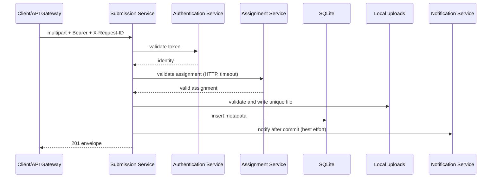

# API Contract — Submission File Service

Base URL lokal `http://127.0.0.1:8105`. Endpoint domain memakai prefix `/api/submissions`. Semua response mengikuti envelope:

```json
{"success":true,"data":{},"meta":{"request_id":"req-001"}}
```

Kesalahan:

```json
{"success":false,"error":{"code":"submission_not_found","message":"Submission tidak ditemukan"},"meta":{"request_id":"req-001"}}
```

`X-Request-ID` opsional pada request; service membuat ID bila tidak ada, mengembalikannya pada header dan `meta`. Endpoint health publik; GET/POST/DELETE submission memerlukan Bearer token yang divalidasi oleh Authentication Service.

## Endpoint

### `GET /health`

Mengembalikan 200 dan `data: {"service":"submission-file-service","status":"healthy"}`.

### `GET /api/submissions?assignment_id=<id>`

Memerlukan Bearer token. Mengembalikan `200` dengan `data.items` (array metadata) dan `data.count`. Daftar kosong adalah hasil valid dengan count 0. `file_path` tidak diekspos.

### `POST /api/submissions`

Memerlukan Bearer token. `Content-Type: multipart/form-data`, field `assignment_id` (string) dan `file` (satu berkas). `user_id` diambil dari identitas Authentication. Assignment diperiksa secara sinkron sebelum file disimpan. Contoh hasil `201`:

```json
{"success":true,"data":{"submission":{"id":"<uuid>","assignment_id":"A1","user_id":"U1","file_id":"<uuid>","original_filename":"jawaban.pdf","stored_filename":"<uuid>_jawaban.pdf","file_type":"application/pdf","file_size":1234,"status":"submitted","created_at":"...","updated_at":"..."}},"meta":{"request_id":"req-001"}}
```

Upload dibaca per chunk dan dibatasi `MAX_UPLOAD_BYTES`; ekstensi/MIME ditentukan konfigurasi. Nama fisik dibuat acak dan lokasi diverifikasi berada dalam direktori upload.

### `DELETE /api/submissions/{submission_id}`

Memerlukan Bearer token. Hapus metadata dan berkas lokal terkait, mengembalikan 200 dengan `data: {"id":"...","deleted":true}`. ID tidak ditemukan menghasilkan 404.

## Status HTTP

| Status | Makna |
|---|---|
| 200 | Health, GET, DELETE berhasil |
| 201 | Submission dibuat |
| 400 | Input tidak valid atau assignment ditolak |
| 401 | Token hilang/tidak valid |
| 404 | Submission atau assignment tidak ditemukan (submission 404; assignment adapter memetakan ke 400 saat ini) |
| 409 | Dicadangkan untuk konflik kontrak/data |
| 413 | Berkas melebihi batas |
| 415 | Ekstensi atau MIME tidak didukung |
| 502 | Respons dependency tidak valid |
| 503 | Dependency tidak tersedia/gagal |
| 504 | Dependency timeout |
| 502 | Dependency mengembalikan status/format yang tidak sesuai kontrak |

Selain status tersebut, kegagalan internal persisten/cleanup mengembalikan 500.

## Data dan ERD

```text
submission
  id (PK), assignment_id, user_id, file_id (UNIQUE),
  original_filename, stored_filename, file_path, file_type, file_size,
  status, created_at, updated_at
```

Satu baris merepresentasikan satu submission dengan satu file. Indeks `assignment_id` melayani filter. `assignment_id`/`user_id` adalah referensi ID lintas layanan, bukan foreign key karena database dimiliki layanan masing-masing. Metadata dan isi file berada di SQLite dan filesystem secara terpisah.

## Alur dan integrasi



Integrasi menggunakan Authentication `GET /api/auth/me`, Assignment `GET /api/assignments?course_id=...`, dan Notification `POST /api/notifications` dengan `user_id`, `message`, `type`, dan `submission_id`. Request ID diteruskan ke dependency. Assignment timeout/unavailable gagal tertutup. Notifikasi gagal dicatat, sementara submission tetap berhasil. Course Service tidak dipanggil langsung oleh Submission Service.

## Batasan operasional

- SQLite dan local storage cocok untuk demonstrasi satu instance; beberapa replica memerlukan shared object storage dan metadata DB terpusat.
- Transaksi SQLite tidak atomik dengan filesystem. Upload dibersihkan jika insert gagal. Penghapusan metadata dilakukan sebelum unlink; bila unlink gagal, API mengembalikan 500 dan log menyatakan metadata telah terhapus, sehingga berkas yatim perlu dibersihkan operasional.
- Notifikasi bersifat best effort tanpa outbox/retry persisten.
- Validasi MIME memakai deklarasi multipart, bukan inspeksi signature isi. Untuk produksi, tambahkan file signature scanning/antivirus.
- Otorisasi kepemilikan submission belum diterapkan; token valid diperlukan untuk operasi domain.
